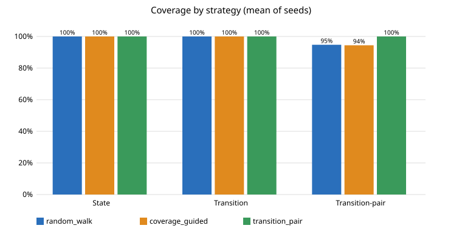
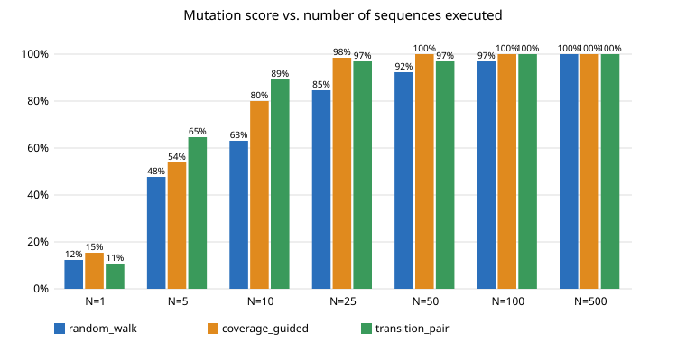
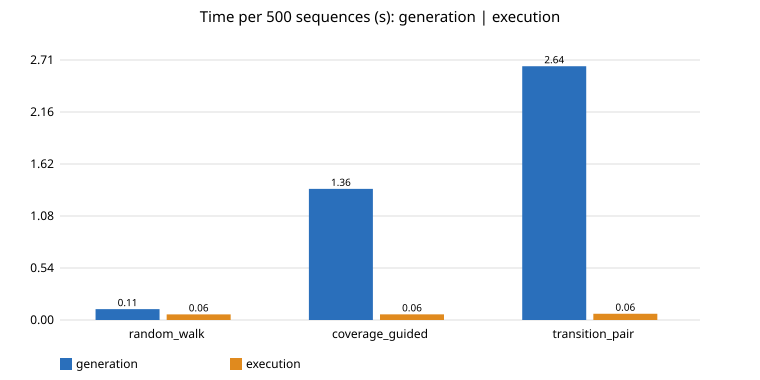
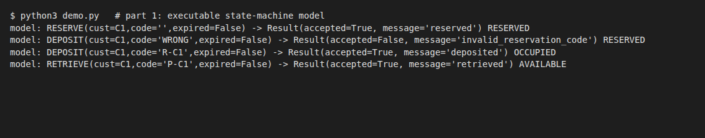
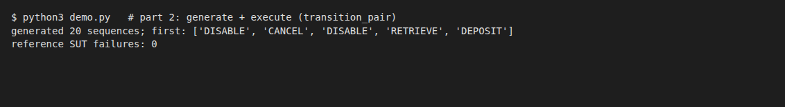
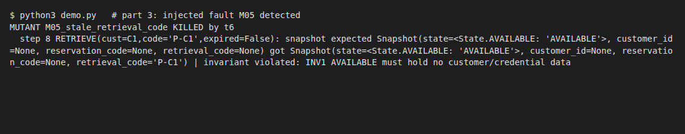
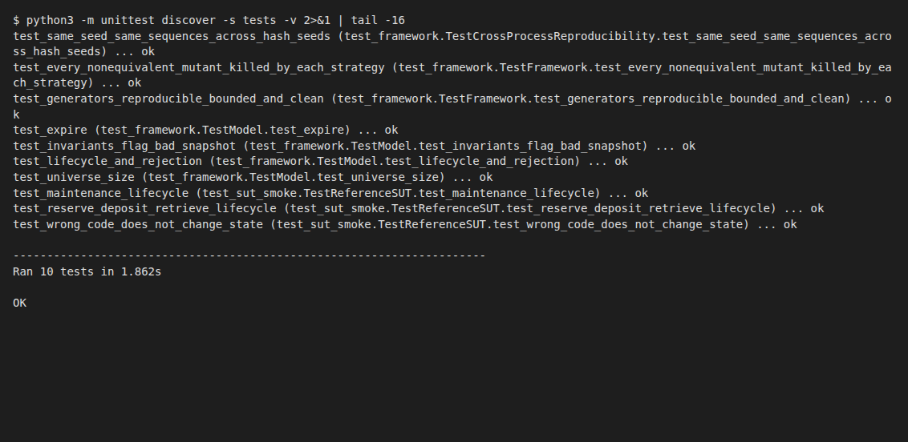
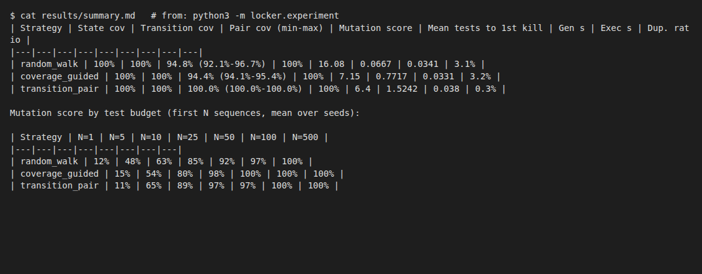

# Technical Report - Model-Based Testing of a Smart Parcel Locker

## 1. Introduction
An executable state-machine model of one locker compartment drives three test-generation strategies. A runner/oracle compares the reference SUT (and 14 mutants) against the model. All numbers below come from `python3 -m locker.experiment` (raw data in `results/`). AI-assisted coding (Claude) was used; all code is reviewed and explainable.

## 2. Requirements and assumptions
Rules 1-12 of `data/requirements.md` are implemented. Added assumptions:
- **A1** Reject precedence: state check, then credential, then expiry flag (e.g. DEPOSIT with a wrong code in AVAILABLE is `not_reserved`).
- **A2** Observable contract = `Result(accepted, message)` + full `Snapshot`; messages are compared (they are the only rejection-reason channel).
- **A3** INVALID_ACCESS is rejected in every state, never mutates.
- **A4** EXPIRE/CANCEL/RETRIEVE clear customer, reservation and retrieval codes (rules 3, 7, 8). DISABLE of OCCUPIED/RESERVED is rejected (rule 9, answers "maintenance while parcel inside": no).
- **A5** Customer IDs drawn from {C1, C2}; customer id is never empty. One compartment only.
- State variables: `customer_id`, `reservation_code = R-<cust>`, `retrieval_code = P-<cust>` (same as snapshot fields; no hidden state).

## 3. State-machine model (`locker/model.py`)
States AVAILABLE, RESERVED, OCCUPIED, MAINTENANCE. Events = 8 operations.

| Op | Accepted when (guard) | Effect | Rejected -> message |
|---|---|---|---|
| RESERVE | AVAILABLE | RESERVED, set customer, `R-c` | `locker_not_available` |
| CANCEL | RESERVED | AVAILABLE, clear | `not_reserved` |
| DEPOSIT | RESERVED and code==`R-c` | OCCUPIED, `P-c` | `not_reserved` / `invalid_reservation_code` |
| RETRIEVE | OCCUPIED and code==`P-c` | AVAILABLE, clear | `no_parcel` / `invalid_retrieval_code` |
| EXPIRE | RESERVED and expired=True | AVAILABLE, clear | `not_reserved` / `not_expired` |
| DISABLE | AVAILABLE | MAINTENANCE | `cannot_disable` |
| ENABLE | MAINTENANCE | AVAILABLE | `not_in_maintenance` |
| INVALID_ACCESS | never | - | `invalid_access` |

Invariants (`check_invariants`): INV1 AVAILABLE/MAINTENANCE hold no customer/credentials; INV2 RESERVED has customer, `R-<cust>`, no retrieval code; INV3/INV4 OCCUPIED has customer and `P-<cust>`; plus rule 12 (rejected => unchanged).

**Independence from the SUT.** The model never imports or calls the SUT. It is structured differently: a pure `_decide` (guard + outcome) separated from `_apply` (effects, run only on acceptance), so "rejection never mutates" holds by construction instead of by careful coding. The oracle adds model-free checks (invariants, SUT-snapshot-unchanged-on-reject), so a requirement misreading shared by model and SUT is still partly caught by invariants. Residual risk: model and SUT written from the same text can share a misreading (see 9).

## 4. Test generation (`locker/generators.py`)
Shared input alphabet (`candidate_commands`): for every state, valid and invalid inputs - correct code, `WRONG`, code of the wrong kind (`P-` for deposit, `R-` for retrieve), other customer's code, expired True/False, both customers.
Sequences start from a fresh locker; length is controlled by `max_length` (=20); seeds via `random.Random(seed)`.

- **A Random walk** - uniform operation choice, then uniform input variant; length uniform in [1,20]; no feedback. + trivially cheap, unbiased; - rare deep states reached by luck, redundant sequences.
- **B Coverage-guided** - at every step peek every candidate on a model clone and choose among those with the least-executed transition (uncovered first, ties random); counters persist across the 500 sequences. + drives transition coverage and finds rare states quickly; - one-step lookahead, label-level coverage blind to data values, ~10x slower generation (cloning).
- **C Transition-pair** - picks a random *uncovered pair* (t1,t2), plans a BFS shortest path on the model to t1, executes t1,t2, then extends greedily choosing commands that complete further uncovered pairs. + reaches 100% pair coverage, nearly no duplicates; - slowest generation, still label-level.
All three differ in mechanism (no feedback / greedy feedback / goal-directed planning), not just parameters.

## 5. Execution and oracle (`locker/runner.py`)
Fresh SUT and model per sequence. After each command: (1) result (accepted, message) equals model, (2) complete snapshot equals model, (3) invariants on SUT snapshot, (4) rejected command left SUT snapshot unchanged, (5) SUT exceptions are failures. First divergence is recorded (index, expected/actual, whole sequence). Records hold test id, strategy, sequence, initial state, expected/actual result, expected/actual final state, PASS/FAIL, details (`raw_tests.csv`). The reference SUT passed all 7500 tests (0 failures).

## 6. Mutation testing (`locker/mutants.py`)
14 mutants (13 non-equivalent). Detection = any sequence fails.

| Mutant | Defect | Exposed by (example, from `mutant_results.csv`) |
|---|---|---|
| M01 | RESERVE accepted in OCCUPIED | DEPOSIT then RESERVE: result/state mismatch |
| M02 | DEPOSIT accepted in MAINTENANCE | DISABLE, DEPOSIT |
| M03 | RETRIEVE without valid code | RESERVE, DEPOSIT, RETRIEVE(WRONG) |
| M04 | EXPIRE ignores flag | RESERVE, EXPIRE(expired=False) |
| M05 | retrieval code retained after retrieve | full lifecycle; snapshot + INV1 violated (see demo) |
| M06 | CANCEL accepted in OCCUPIED | deposit then CANCEL |
| M07 | rejected wrong-code DEPOSIT erases reservation code | RESERVE, DEPOSIT(WRONG): snapshot diff + "rejected mutated state" |
| M08 | DISABLE accepted in RESERVED | RESERVE, DISABLE |
| M09 | ENABLE accepted in AVAILABLE | ENABLE on fresh locker |
| M10 | INVALID_ACCESS cancels reservation | RESERVE, INVALID_ACCESS |
| M11 | EXPIRE leaves customer_id | RESERVE, EXPIRE(True): snapshot diff |
| M12 | DEPOSIT accepts any `R-*` code | RESERVE(C1), DEPOSIT(code=R-C2) - needs cross-customer input |
| M13 | rejected RESERVE overwrites customer_id | RESERVE(C1), RESERVE(C2) - needs 2nd customer |
| M14 | RESERVE also sets retrieval_code=None | **equivalent**: retrieval_code is already None in AVAILABLE, the mutation is unobservable; excluded from score, survived in 100% of runs |

Mutation score = killed / 13. M14 is reported separately.

## 7. Experimental setup
3 strategies x 5 seeds (1-5) x 500 sequences, max length 20, 14 mutants; Python 3.12, Linux, single process. Metrics: state coverage (4), transition coverage (35 = every reachable (src,op,outcome,dst); accepted and rejected outcomes are distinct transitions, enumerated by BFS over the model), **transition-pair coverage** (305 pairs (t1,t2) with t1.dst==t2.src, counted only for adjacent commands in the same sequence), mutation score, generation/execution time, duplicate-sequence ratio, plus mutation score as a function of test budget N (first N sequences).

## 8. Results (mean over 5 seeds; produced by `python3 -m locker.experiment`)
| Strategy | State | Transition | Pair (min-max) | Mutation score | Mean tests to 1st kill | Gen s | Exec s | Dup. |
|---|---|---|---|---|---|---|---|---|
| random_walk | 100% | 100% | 94.8% (92.1-96.7) | 100% | 16.08 | 0.067 | 0.034 | 3.1% |
| coverage_guided | 100% | 100% | 94.4% (94.1-95.4) | 100% | 7.15 | 0.772 | 0.033 | 3.2% |
| transition_pair | 100% | 100% | 100.0% (100-100) | 100% | 6.40 | 1.524 | 0.038 | 0.3% |

Mutation score vs budget (first N sequences):
| Strategy | N=1 | 5 | 10 | 25 | 50 | 100 | 500 |
|---|---|---|---|---|---|---|---|
| random_walk | 12% | 48% | 63% | 85% | 92% | 97% | 100% |
| coverage_guided | 15% | 54% | 80% | 98% | 100% | 100% | 100% |
| transition_pair | 11% | 65% | 89% | 97% | 97% | 100% | 100% |

Per-mutant detail (kill rate, tests-to-first-kill, first killing sequence and observed failure for every strategy/seed): `results/summary.md`, `results/mutant_results.csv`. Reference SUT: 0 failures in all 7500 tests. M14 survived in 15/15 runs (equivalent, section 6).

## 9. Discussion
- **Highest state/transition coverage:** all tie at 100%/100% at 500 sequences (small model). **Pair coverage:** only C reaches 100%; A and B plateau at ~94-95% - some rare 2-step combinations are never produced in 500 tests by random choice or one-step greedy guidance.
- **Most mutants:** all kill 13/13 in every seed at 500 tests, so the minimum protocol cannot separate them. Separation appears under small budgets: at N=10 C 89% vs B 80% vs A 63%. At N=50 B is already 100%, C 97% (M12, M13 still pending), A 92%.
- **Higher coverage => higher score?** Not at full budget (A, B have lower pair coverage but equal score), and not per mutant: M13 (second customer needed on a rejected RESERVE) took A 4.0 tests but B 11.2 and C 16.0; M12 (cross-customer code) took ~14-16 tests for all three. Label-level coverage ignores data values, so a coverage-driven strategy can steer away from the input that matters. Conversely M05 (stale credentials after a *completed* lifecycle) needed 83 tests under A vs 8.2 (B) and 4.6 (C): deliberate sequence construction wins when the fault needs a specific deep path.
- **Efficiency:** A generates 500 tests 11.6x faster than B and 22.8x faster than C (0.067 s vs 0.77 s vs 1.52 s; B/C pay for model cloning and BFS), execution time is equal (~0.035 s). But A needs 2.5x more tests to first kill than C (16.1 vs 6.4). At this model size everything takes seconds, so test count - which costs in real SUT executions - is the meaningful cost.
- **Redundancy:** A and B generated ~3% duplicate sequences (short sequences repeat), C 0.3%.
- **Strengths/limits:** A: cheap, unbiased, weak on deep paths. B: fast convergence on transition coverage, one-step horizon, data-blind. C: best fault-per-test and full pair coverage, most expensive generation, still data-blind.
- **Threats to validity:** a single small model (4 states) so coverage saturates and the score ceiling hides differences; 14 hand-written mutants by the same author (bias, resemble oracle checks); model, oracle and SUT derived from the same requirement text so a shared misreading is possible; assumptions A1/A2 (reject precedence, message comparison) would flag a differently-ordered but valid SUT; 5 seeds is a small sample (pair-coverage range shown); wall-clock timings are single-machine; reproducibility was verified across `PYTHONHASHSEED` values (an early version depended on set ordering and was fixed, `tests/test_framework.py`).

## 10. Conclusion
All strategies reach full state/transition coverage and a 100% mutation score with 500 sequences. Transition-pair planning gives complete pair coverage and the best early detection per test, coverage-guided is a cheap middle ground, random is fastest to generate but needs the most tests and is weakest on faults requiring deep sequences (M05). Coverage did not predict detection for data-dependent faults (M12, M13). Improvements: data-aware coverage (customer/credential classes), longer lookahead or mutant-feedback guidance, multi-compartment model, instructor-supplied variants.

## 11. Demonstration (screenshots of `python3 demo.py`, the unit tests and the experiment)
1. Executable model (valid and rejected commands): 
2. Test generation and execution against the reference SUT: 
3. Injected fault M05 detected: 
4. Unit tests: 
5. Experiment results: 
